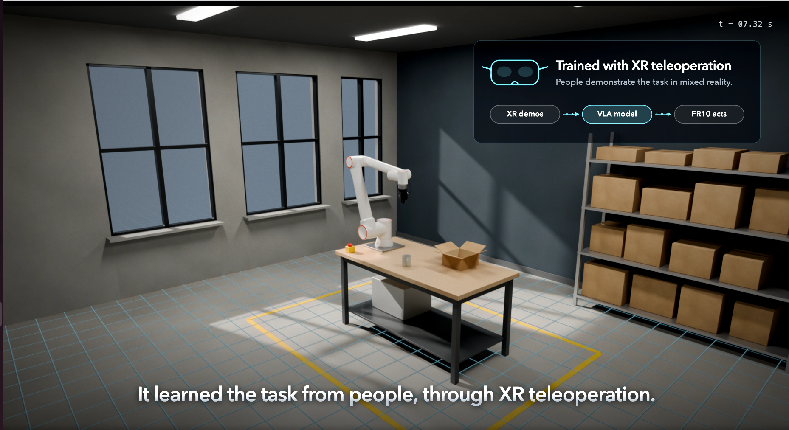

# FR10 XR Teleoperation

Control a FAIRINO FR10 arm with your hands from a Meta Quest headset.



## Quick start (real robot)

**1. Start the program** on the PC:

```bash
cd fr10_teleop
./scripts/start_teleop_real.sh
```

**2. Open this URL in the Meta Quest browser** (the script prints it with your PC's IP):

```
https://<PC_IP>:8012/?ws=wss://<PC_IP>:8012
```

Accept the certificate warning, then tap **Enter VR**.

**3. Wait for the gripper to finish activating** (a few seconds), then **press `r`** in the terminal.
The arm moves to its ready pose. Clear the path before you press `r`.

**4. Make a fist with your left hand** to start control. The arm follows your right hand.
Open the left hand to stop.

- Hold your right hand palm down, fingers forward.
- Pinch or close your right hand to close the gripper.

## Simulation

```bash
./scripts/start_sim.sh          # terminal 1: wait for "FR10 simulator running"
./scripts/start_teleop_sim.sh   # terminal 2: open the URL, press r, hold the right grip button
```

## Keys (in the terminal, no Enter)

| Key | Action |
| --- | --- |
| `r` | Start / resume after a stop or fault |
| `Space` | **Stop the arm immediately** |
| `h` | Go to the home pose |
| `o` / `g` | Open / close the gripper |
| `c` | Start/stop recording an episode (with `--record`) |
| `+` / `-` | Faster / slower |
| `x` | Reset the simulator scene |
| `q` | Quit |

## Good to know

- The headset and PC must be on the same network. HTTPS certificates: see [TeleVuer's README](../teleop/televuer/README.md).
- Robot IP defaults to `192.168.58.2`. Change it with `--robot-ip`, and set the FAIRINO SDK folder with `--sdk-path`.
- Change any setting with `--set section.key=value`, e.g. `--set control.speed_scale=0.3`. Defaults are in `config/default.yaml`.
- The arm pauses about 1 s for each gripper move (the controller needs it).
- Recordings are saved to `data/<task>/episode_NNNN/`.
- The Orbbec Gemini 2 camera: `python camera_fr10.py --config config/orbbec_gemini2.yaml`.
- Try it without hardware: `python teleop_fr10.py --robot mock --input scripted --auto-start --duration 5 --no-images`.
- Run tests: `python -m unittest discover -s tests`.

## Setup

```bash
conda create -n xr -c conda-forge python=3.10 pinocchio=3.2.0 casadi=3.6.7
conda activate xr
pip install -r requirements.txt
pip install -e ../teleop/televuer
pip install -r requirements-camera.txt   # only for the Orbbec camera
```

The simulator runs in a separate Isaac Lab environment (`env_isaaclab`).
